# Hermlet

**Your own Hermes agent, on a Raspberry Pi with a screen.** Walk up to it, type or talk, hand it
a file, and your agent answers. Every conversation you have had with it elsewhere (Discord, the
terminal, the web) is one tap away.

Hermlet is a small open-source SDK and app for personal devices that talk to *your* self-hosted
[Hermes Agent](https://github.com/NousResearch/hermes-agent). Nothing needs installing on the
Hermes side.

<p align="center">
  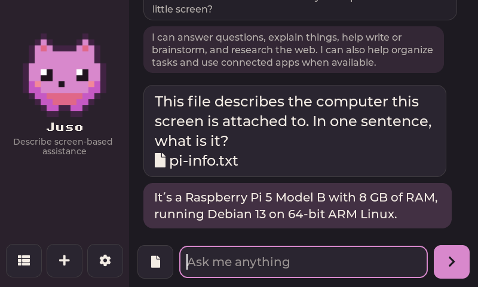
  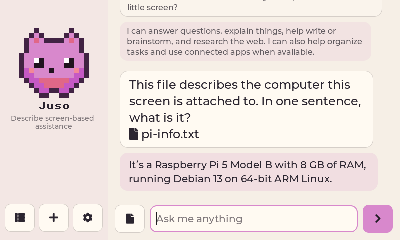
</p>

<p align="center"><sub>Both pictures were drawn on a Raspberry Pi 5 talking to a real Hermes. <a href="#real-numbers-from-a-raspberry-pi-5">Numbers below.</a></sub></p>

## Set it up

You need two things: a Hermes you already run, and a Raspberry Pi (or any Linux machine) that can
reach it. [Tailscale](https://tailscale.com) on both is the easy way to make that true from
anywhere without exposing anything to the internet.

**1. Get your Hermes ready** (once). Open your Hermes dashboard in a browser. If it loads at an
address like `https://hermes.your-tailnet.ts.net` and asks for a username and password, you are
done. If not, paste [prompts/setup-hermes.md](prompts/setup-hermes.md) into a chat with your
Hermes and it will set that up for you.

**2. Install on the Pi.**

```sh
git clone https://github.com/j4ckxyz/hermlet.git
cd hermlet
bash install.sh
```

**3. Open Hermlet.** It is in the Pi's menu, or run `hermlet-app`. The first time, it asks where
your Hermes is, then for your dashboard username and password, then what to call your hermlet.
That is the whole setup: there is nothing to start first and no settings file to edit, because
the app starts everything it needs. The password is used once to sign in and is never stored.

<p align="center">
  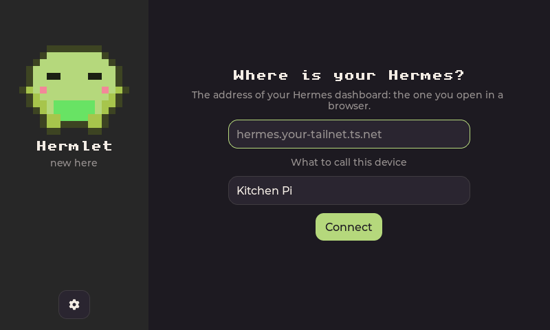
  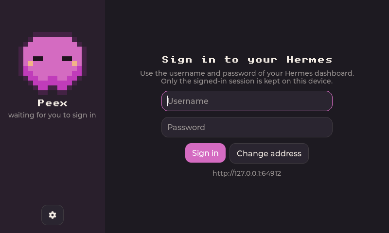
  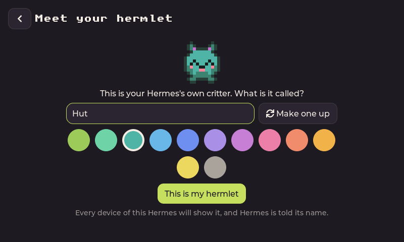
</p>

No screen on the device? `hermlet setup` asks the same questions in a terminal, and
`hermlet chat` is the same conversation there.

Something not working? `hermlet doctor` says what and how to fix it. Setting up over SSH with a
coding agent helping? Hand it [prompts/setup-device.md](prompts/setup-device.md).

## What it is

A place to go to, rather than another chat window.

| | |
|---|---|
| **Type, talk, drop a file** | Start typing and it lands in the prompt. Tap the microphone to talk, tap again to send. Drag a file onto the window, or pick one. Speech is turned into text by your Hermes. |
| **Made for a touch screen** | On a small panel the buttons grow to finger size and an on-screen keyboard appears, so a Pi with a 3.5" screen is a device in its own right. |
| **Every conversation, everywhere** | Chats are ordinary Hermes sessions, tagged `hermlet`. Your Discord, Telegram, terminal and web conversations sit beside them, searchable, and any of them can be carried on from the device. |
| **Your hermlet** | Each Hermes gets one pixel critter. You name it and choose its colour, or let it make up its own name. Every device of that Hermes shows the same one, and Hermes itself knows what it is called. |
| **Restyle it, or just ask** | Theme, accent colour, font, text size, corners, playful or plain. Change it in Settings, with `hermlet look`, or say *"make the accent red and use a code-style font"* and your agent does it while you watch. |
| **Cheap to leave running** | After 20 idle minutes the next visit starts a fresh conversation, so you are not paying to re-send yesterday's chat on every turn. You can change or switch off that timer, and old conversations stay in the history. The app itself adds about 110 tokens to each conversation. |
| **Made to be built on** | `hermlet.connect()` in Python, or JSON lines on a local socket from any language. Your own app never touches a password. |

<p align="center"></p>

## How it works

```
 your device (Raspberry Pi, any Linux)              your Hermes (VPS, home server)
┌──────────────────────────────────────┐           ┌──────────────────────────────┐
│ hermlet-app     your apps    hermlet │           │  hermes dashboard            │
│      │              │         send   │           │   /api/ws    chat, sessions  │
│      └──────┬───────┴──────────┘     │ Tailscale │   /api/sessions   history    │
│     local socket (JSON lines)        │◄─────────►│   /api/audio      voice      │
│      hermlet run  (the service)      │           │  state.db  every conversation│
└──────────────────────────────────────┘           └──────────────────────────────┘
```

- **One small service, `hermlet run`,** holds the connection to Hermes and shares it with
  everything on the device through a local socket. The app, the `hermlet` command and anything
  you write all talk to that socket. You never start it by hand: the app does when it opens,
  and `hermlet service install` keeps it running from boot.
- **It speaks the API Hermes already has**: the one the Hermes desktop app uses. No plugin, no
  restart, no new port. Conversations are stored by Hermes in its own session store, next to
  everything else you have said to it.
- **A few small things live on Hermes** so every device agrees: your hermlet's name and colour,
  the app's look, a skill that teaches the agent how to restyle the app, and one line in the
  agent's own notes so it knows its critter's name. They are written through Hermes's own file
  API when you name your hermlet; delete them and Hermes is as it was.
- **An optional plugin** adds what that API cannot do: letting the agent call actions on the
  device (a lamp, a camera) and reach it unprompted. Most people will not need it;
  [docs/two-ways.md](docs/two-ways.md) compares the two.

## See it working

| | |
|---|---|
|  | 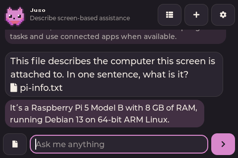 |
| First run: name your hermlet and choose its colour | A 480x320 touch panel: bigger buttons, less chrome |
| 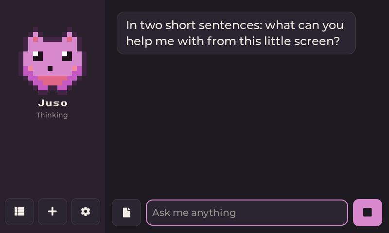 | 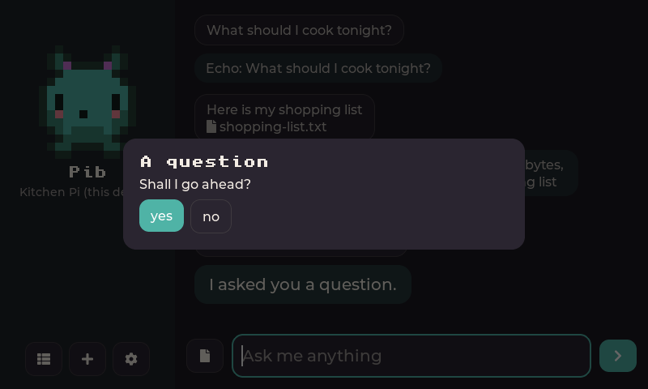 |
| While it works: the critter thinks, and send becomes stop | The agent can ask before it does something |
| 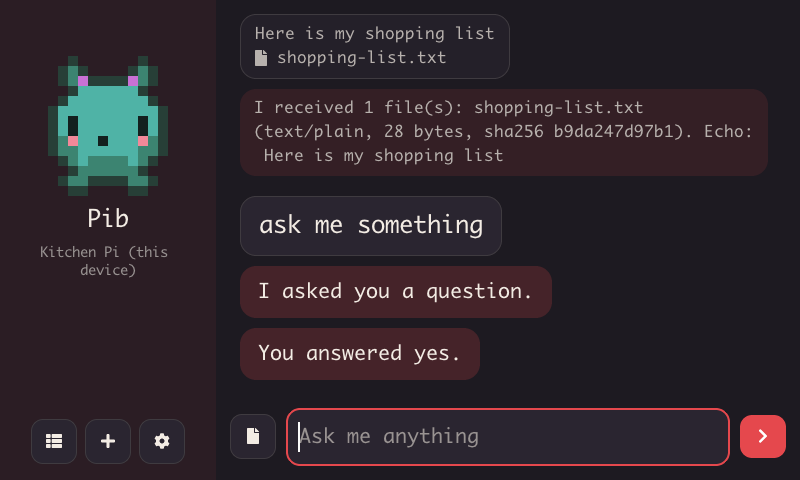 | 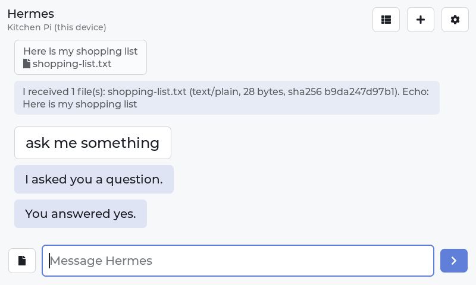 |
| After asking *"make the accent red and use a code-style font"* | The plain look, for when the critter is too much |
| 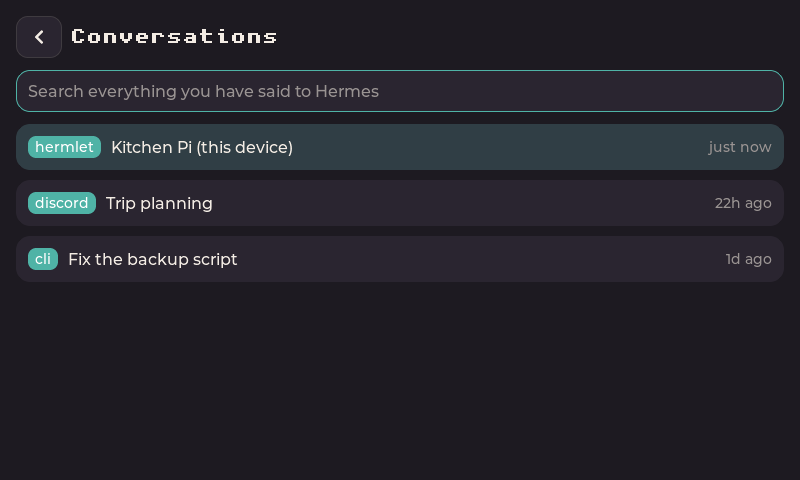 | 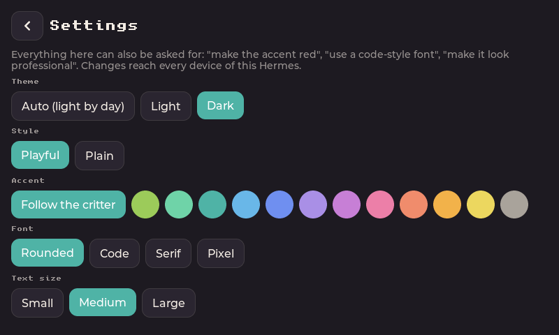 |
| History from every surface, with search | Settings, shared by all your devices |

What you say sits in a plain box and what the agent says in one tinted with your accent colour.
The exchange happening now is set larger than what came before, and replies are written out as
they arrive. With text-to-speech set up on your Hermes and a speaker on the device, answers can be
read aloud as well.

The pictures in `docs/pi5` come from the Pi; the others were drawn on a laptop against the
built-in development server, which echoes what you send.

## Real numbers from a Raspberry Pi 5

Measured on a Raspberry Pi 5 (8 GB, Debian 13, 64-bit) with no screen attached, talking over
Tailscale to Hermes Agent 0.21.5 on another machine.

| | |
|---|---|
| Automated tests | 47 pass, in 17 seconds (one more, which needs a Hermes checkout, is opt-in) |
| Building the app from source | 43 seconds (plus about 40 seconds to fetch its two libraries) |
| The app binary | 1.1 MB, needing only the C library |
| The app starting | about 10 milliseconds to its first drawn frame |
| Memory: the app | 4 MB |
| Memory: the service | about 40 MB |
| `hermlet setup`: sign in and connect | 2.3 seconds |
| A question to a finished answer | 4.5 seconds (the time is the model's, not the Pi's) |
| A question with a file attached | 3.3 to 4.7 seconds |

The Pi was asked, with a text file describing itself attached, what computer it was running on.
It answered: *"It's a Raspberry Pi 5 Model B with 8 GB of RAM, running Debian 13 on 64-bit ARM
Linux."* (That is the conversation in the pictures at the top.)

What that run did not cover is as important: there was **no physical screen, touch panel,
microphone or speaker** on that Pi, so those have been drawn and wired up but not used by a
person. The full record, including what has not been tried, is in [docs/tested.md](docs/tested.md).

## Build on it

```python
import hermlet

h = hermlet.connect()                      # the service on this machine; no passwords

print(h.ask("Is it going to rain today?"))

h.send("The garage door has been open for an hour.", files=["snapshot.jpg"])

for event in h.events():                   # everything, as it happens
    if event["type"] == "reply":
        print(event["text"])
```

| Start here | For |
|---|---|
| [AGENTS.md](AGENTS.md) | Coding agents (and people) building an app or changing the SDK |
| [docs/local-api.md](docs/local-api.md) | The local socket: every operation and every event |
| [examples/](examples) | A doorbell with a camera, an action the agent can call, an event ticker, a client with no SDK |
| [docs/two-ways.md](docs/two-ways.md) | The dashboard route and the optional plugin, compared |
| [docs/tested.md](docs/tested.md) | What has been run, on what, with timings |

No Hermes to hand? `hermlet devserver` stands in for one, so an app can be built and tested on a
laptop.

More from the command line:

```sh
hermlet send -a photo.jpg "what plant is this?"
hermlet sessions                          # past conversations from every surface
hermlet look accent=red font=mono         # restyle every device of this Hermes
hermlet critter --name Pib --colour teal
hermlet service install                   # keep it connected in the background
```

## Status

Version 0.1, and young. It has been built and run on a Raspberry Pi 5 against a live Hermes, but
not yet with a real screen, touch panel, microphone or speaker attached, and not on a smaller Pi.
The installer's last step (building the app with its window library) has not been run on a Pi
either, and setting up from inside the app has so far been run on a laptop only. Expect to find something on first contact with your hardware, and please say what.

One thing to know before you rely on it: a device keeps a signed-in session with your Hermes
dashboard, and that dashboard can change your Hermes configuration. Treat a hermlet like a
logged-in laptop. [docs/two-ways.md](docs/two-ways.md) explains this and what to do if a device
is lost.

## Credits

Hermlet stands on other people's ideas.

- **[Muse Gadgets](https://github.com/facebookincubator/muse-gadget-sdk)** by Meta showed the shape
  of the thing: an SDK you install on a spare Linux box to give your own agent a body, with a
  README for people and an `AGENTS.md` for coding agents.
- **[Hermes Gadget](https://github.com/Adolanium/hermes-gadget-sdk)** by Adolanium and contributors
  showed how a device can join Hermes as a messaging platform, with pairing codes and a
  per-device key. The optional plugin here follows that approach. If you want a voice-first
  ESP32 gadget, go there.
- **[Hermes Agent](https://github.com/NousResearch/hermes-agent)** by Nous Research is the agent
  all of this talks to.
- The app is drawn with [LVGL](https://github.com/lvgl/lvgl) and reads JSON with
  [cJSON](https://github.com/DaveGamble/cJSON).

This is an unofficial community project. It is not affiliated with or endorsed by Nous Research,
Meta or the Hermes Gadget project, and uses their names only to say what it works with and where
its ideas came from.

## Licence

MIT; see [LICENSE](LICENSE) and [NOTICE](NOTICE).
